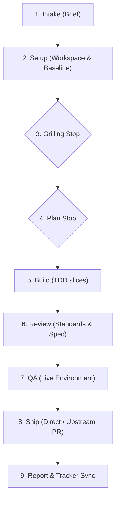

# Delivery Suite (`flyingnobita-deliver`)

An evidence-bound multi-agent delivery orchestration suite for autonomous software engineering. Coordinates end-to-end delivery runs from an agreed brief through grilling, planning, test-first implementation (TDD), independent multi-axis review, QA, and verified shipping.

## Companion Skills

The suite consists of four companion skills:

| Skill | Purpose | Invocation |
|---|---|---|
| [`flyingnobita-deliver`](skills/flyingnobita-deliver/SKILL.md) | Coordinates full end-to-end delivery runs | `deliver <input>` (issue URL, `#N`, spec, or brief) |
| [`flyingnobita-deliver-setup`](skills/flyingnobita-deliver-setup/SKILL.md) | Verifies prerequisites, configures role profiles, and validates hosts | `/flyingnobita-deliver-setup` |
| [`flyingnobita-deliver-review`](skills/flyingnobita-deliver-review/SKILL.md) | Standalone branch review and repair across Standards and Spec axes | `/flyingnobita-deliver-review` |
| [`flyingnobita-deliver-retro`](skills/flyingnobita-deliver-retro/SKILL.md) | Retrospective analysis of coordination and role efficiency across delivery runs | `/flyingnobita-deliver-retro` |

## Installation

Install the suite using the [Skills CLI](https://github.com/vercel-labs/skills) (`skills` or `npx skills`):

### Global Installation (recommended)

Install all four companion skills globally for your coding agents:

```bash
skills add flyingnobita/flyingnobita-deliver -g
```

Or using `npx`:

```bash
npx skills add flyingnobita/flyingnobita-deliver -g
```

### Repository-Local Installation

To install only for the current project:

```bash
skills add flyingnobita/flyingnobita-deliver
```

### Updating

The Skills CLI `update` command accepts installed skill names rather than repository slugs:

```bash
# Update the four companion skills globally
skills update flyingnobita-deliver flyingnobita-deliver-setup flyingnobita-deliver-review flyingnobita-deliver-retro -g

# Or update all installed global skills
skills update -g

# Or perform an idempotent source reinstall from the latest default branch tip
skills add flyingnobita/flyingnobita-deliver -g -y
```

### Branch Tip vs. Tagged Releases

- **Branch-tip installation**: Running `skills add flyingnobita/flyingnobita-deliver` installs from the default branch tip (`main`), receiving the latest verified changes on subsequent reinstalls or updates.
- **Tagged releases**: GitHub Releases (e.g. `v0.1.0`) represent immutable versioned releases accompanied by changelogs and release notes. To pin or install a specific release milestone rather than the branch tip, append the tag ref:
  ```bash
  skills add flyingnobita/flyingnobita-deliver#v0.1.0 -g
  ```

## Prerequisites

- **Environment**: Linux or macOS.
- **Tools**:
  - `git` (with configured `user.name` and `user.email`)
  - `gh` ([GitHub CLI](https://cli.github.com), authenticated via `gh auth login`)
  - Python 3.11+ (standard library with `tomllib` and `unittest`)
- **Delivery Hosts** (at least one confirmed):
  - [Herdr](https://github.com/herdrdev/herdr) ([herdr.dev](https://herdr.dev))
  - [Paseo](https://github.com/getpaseo/paseo) ([paseo.sh](https://paseo.sh))
  - [Orca](https://github.com/stablyai/orca) (macOS: `brew install --cask stablyai/orca/orca`; Linux: `stably-orca-bin` or `orca-ide-bin`; [onorca.dev](https://www.onorca.dev)) — Orca bundles its own version-matched orchestration guide, loaded directly via `ORCA skills get orchestration --full` without requiring an external skill download. On Linux outside an Orca-managed terminal, resolve the CLI as `orca-ide` (never bare `orca`, which starts the GNOME screen reader).
- **Dependency Skills**:
  The suite relies on Matt Pocock's workflow skills, resolved under either their upstream names or `mattpocock-` prefixed names:
  - `grilling` (or `mattpocock-grilling`)
  - `tdd` (or `mattpocock-tdd`)
  - `code-review` (or `mattpocock-code-review`)
  - `pr` (or `mattpocock-pr`)
  - `diagnosing-bugs` (or `mattpocock-diagnosing-bugs`)
  - `domain-modeling` (or `mattpocock-domain-modeling`)
  - `wizard` (or `mattpocock-wizard`)
  - `writing-for-agents` (or `mattpocock-writing-for-agents`)

  Install them from upstream:
  ```bash
  skills add mattpocock/skills -g
  ```

Run `/flyingnobita-deliver-setup` to verify prerequisites and inspect your environment.

## Workflow Overview

Every delivery run coordinates roles through a deterministic pipeline:



- **Stops**: The orchestrator only pauses to wait for user interaction at designated stops: Grilling, Plan approval, Scope changes, and upstream PR review. All other steps execute autonomously.
- **Evidence-based**: Role reports never substitute for independent verification. The orchestrator independently verifies tests, red checks on base commits, linters, and review findings.
- **Repository Authority**: Write access never grants merge authority. Direct merges require explicit repository consent (`AGENTS.md` autonomous delivery rule) or session approval, and branch protections are always respected.
- **Commit Rules**: Built-in safe commit behaviors follow the target repository's conventions. A custom commit skill (such as `flyingnobita-clean-commit`) can be optionally configured.

## Configuration

Project configuration is optional and lives in `docs/agents/delivery.toml`:

```toml
[delivery]
max_workers = 3
human_schedule = "normal" # normal | front-load | back-load
landing = "standard"      # standard | leave | pr
commit_skill = ""         # optional custom commit skill name

[hosts.orca.roles.planner]
harness = "codex"

[hosts.orca.roles.implementer]
harness = "codex"

[hosts.orca.roles.reviewer]
harness = "claude"

[hosts.orca.roles.qa]
harness = "codex"
```

## Running Tests

The test suite exercises the runtime and preflight boundaries using standard Python `unittest`:

```bash
python3 tests/test-deliver-runtime.py
python3 tests/test-deliver-orca-preflight.py
```

## License

[MIT](LICENSE) © 2026 flyingnobita
